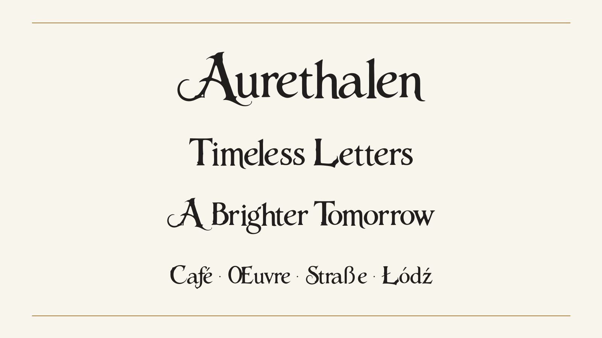

# Aurethalen

An ornamental Latin display typeface by **The Gilded Threshold**, with pointed serifs, strong stroke contrast and sweeping flourishes. Made for book covers, headings, invitations and imaginative storytelling.

## Download

- [Installable desktop font — Aurethalen-Regular.ttf](Aurethalen-Regular.ttf)
- [Complete package — Aurethalen-v1.101.zip](Aurethalen-v1.101.zip), including editable UFO sources, build files, desktop/web fonts, specimen images and documentation
- [Webfont — Aurethalen-Regular.woff2](Aurethalen-Regular.woff2)

Open the TTF on Windows or macOS and choose Install. In your app, select **Aurethalen**. Enable kerning and standard ligatures where available, and allow room for its flourishes.

Version 1.101 has all 319 required Google Fonts Latin Core codepoints, 379 Unicode mappings and 423 glyphs. It includes accented letters, combining marks, punctuation, symbols, ff/fi/fl/ffi/ffl ligatures, tabular figures, superscripts, subscripts and fractions.

## Free and open

The font and design sources are licensed under **SIL Open Font License 1.1**. Personal and commercial use are permitted under its terms; see [OFL.txt](OFL.txt). No Reserved Font Name is declared.

The font specimen images use [CC BY-SA 4.0](specimen-image-license.txt). The lantern-and-arch profile PNG has a separate [CC BY-SA 4.0 notice](profile-image-license.txt). These image grants do not cover the complete tarot cover or other studio artwork. Refer to the notices within the full ZIP for the corresponding image paths and attribution.

## Sources and build

Extract the complete ZIP. Its root contains `sources/Aurethalen.ufo`, the authoritative editable master, plus build requirements and documentation. With Python 3.12 and a virtual environment, install `requirements.txt` and run `python sources/build.py`. That builds TTF and WOFF2 without overwriting the master. Historical derivation inputs retain their original names for provenance.

## Creation and validation

The source lettering image was generated in Microsoft Edge's AI theme generator using the owner's description: “mystical, dark mode. make the text a bright vibrant gold”. No external image or font sample was identified by the owner. AI assistance also supported tracing, added-character construction, font engineering and documentation. The studio emblem was created with ChatGPT from the owner's descriptions, without reference material or other parties, and adapted from the approved print cover for the profile PNG.

Local technical checks report zero failures or errors. Retained warnings and testing limits are recorded in [QUALITY.md](QUALITY.md). This is an **independent release, not a Google Fonts approval or catalog listing**.

## Support

The font is provided as-is. **No ongoing user support, updates or repository maintenance are promised.** Others may modify and redistribute it under OFL 1.1.

The Gilded Threshold
